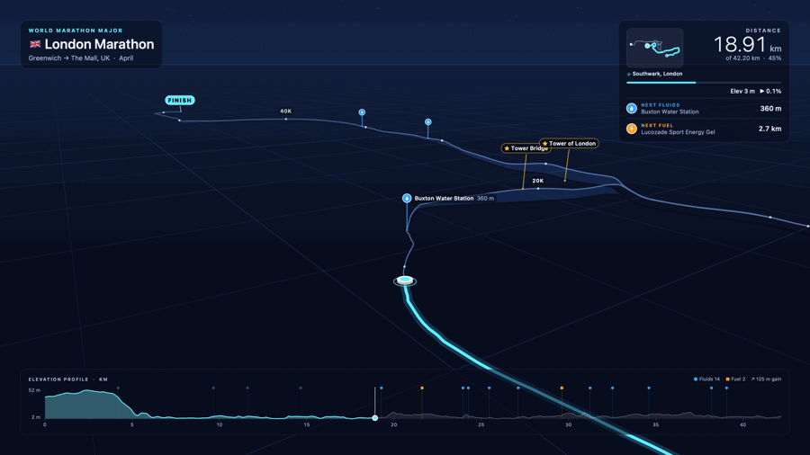

# Race Flyover

A Mac screensaver that flies along the world's major marathon courses, so you learn the route before race day.



## Features

- **14 marathons**, including all seven World Marathon Majors: Boston, London, Berlin, Chicago,
  New York, Tokyo and Sydney. Also Kyoto, Osaka, Amsterdam, Paris, Valencia, Los Angeles and Houston.
- **Apple Maps in 3D.** The route is drawn on real streets, with satellite or map views and 3D buildings.
  There are also five drawn styles that work offline.
- **Water and fuel stations**, with the next ones shown on screen and how far away they are.
- **Distance markers** every kilometre or mile, and a marker at halfway.
- **Landmarks** labelled as you pass them. The camera slows down and circles them for a better look.
- **A minimap and an elevation profile**, so you always know where you are and when the hills come.
- **A camera that follows the road**: higher on long straights, lower and tilted through bends.
- **Settings for everything**: which races to play, how long a lap takes (2 minutes to 4 hours),
  km or miles, pin and trail colours, and which panels to show.

## Requirements

- macOS 14 Sonoma or later, on Apple silicon or Intel.
- macOS 26 or later for the Liquid Glass panels.
- An internet connection for the Apple Maps styles, place names and landmarks. The drawn styles work offline.
- Xcode or Apple's Command Line Tools to build it.

## Install

Download the installer from the [releases page](../../releases) and run it — it puts
Race Flyover in `/Library/Screen Savers`. The installer isn't signed with an Apple
Developer ID, so the first time, **right-click the .pkg and choose Open**. After
installing, open **System Settings › Screen Saver**, scroll to **Other** and choose
**Race Flyover**. Click **Options…** to change the settings.

The installer is built by `.github/workflows/installer.yml`, which runs on every `v*` tag
(and on demand) and attaches the `.pkg` to the release. See [docs/RELEASING.md](docs/RELEASING.md)
for how to cut a release and how to sign the installer.

## Build

```bash
./build.sh install    # build and install the screensaver
./build.sh preview    # build and open it in a window
./build.sh release    # build and zip it for a GitHub release

tools/build_installer.sh    # package build/RaceFlyover.saver as a .pkg installer
```

In the preview window: **Space** pauses, **← / →** jumps 1 km, **N** goes to the next course.

To add a race, add it to the list in `tools/build_courses.py`, run the script, then `./build.sh install`.
The preview app can also save still images and GIFs; its options are listed at the top of
`Sources/Preview/main.swift`.

## Notes

- **Performance.** Apple Maps with 3D buildings uses the most power. If playback stutters, set the
  frame rate to 30 fps, turn off 3D buildings, or choose **Main display only** when you have more
  than one screen. The drawn styles are much lighter.
- **Accuracy.** Courses follow published race routes and are scaled to exactly 42.195 km, but routes
  change each year. Where a race didn't publish its stations, typical ones are shown every 5 km.
  Always check your race's official course map.
- **Course data.** Most routes and stations come from
  [distanzrunning/gpx](https://github.com/distanzrunning/gpx), which has no stated licence. Kyoto and
  Hong Kong routes come from [GoAndRace](https://www.goandrace.com). 
