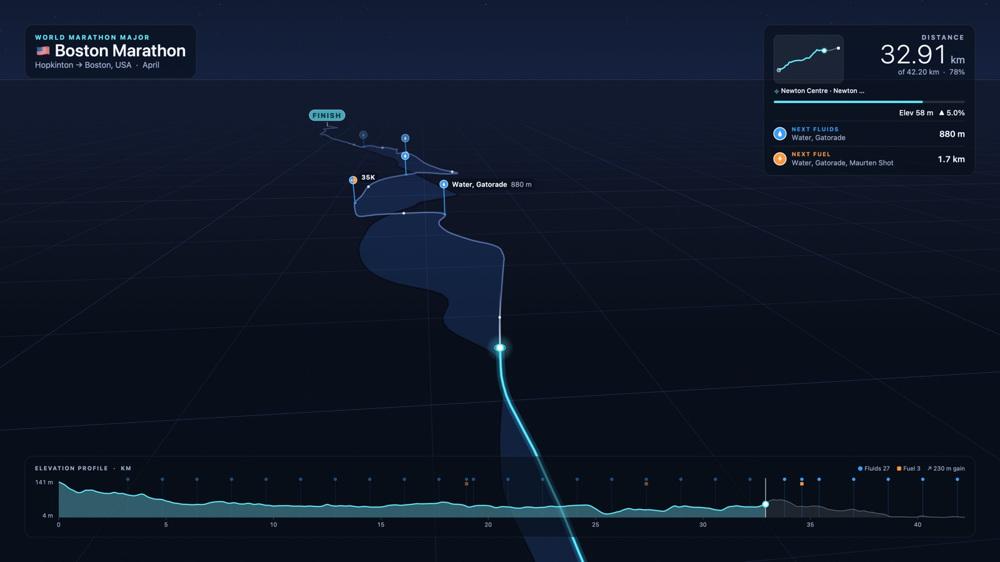
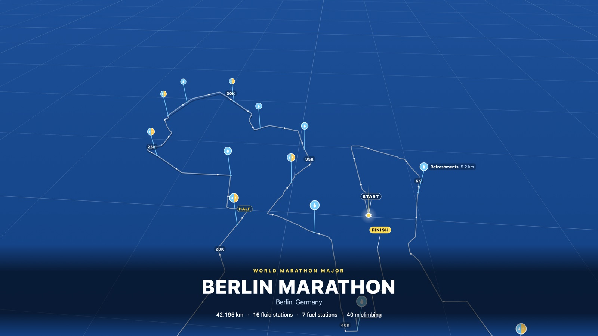

# Race Flyover — a macOS screensaver for learning marathon courses

Race Flyover animates a runner along a race course and flies a camera behind it.
Fluid and fuel stations stand along the route as pins, with distance markers, an
elevation curtain and a live elevation profile. It works as a detailed street-level
flyover or as a calm overview running in the background.

## Screenshots


*London Marathon over Apple Maps imagery, approaching Tower Bridge at 20K: minimap with the current neighbourhood, next fluid and fuel stations, and the elevation profile. (Rendered with the snapshot tool; the live screensaver adds Apple Maps' 3D terrain and buildings.)*

| | |
|---|---|
|  |  |
| **Midnight** · Boston, nearing Heartbreak Hill, with the elevation curtain | **Daylight** · New York in miles, with fluid stations every mile |
|  |  |
| **Neon Grid** · Tokyo, set in Avenir Next | **Intro card** · Berlin in Blueprint, before the camera swoops in |
|  | |
| **Finish card** · Chicago, as the camera pulls back over the course | |

## Build & install

```bash
./build.sh install
```

Then open **System Settings › Screen Saver**, pick **Race Flyover**, and click **Options…**.

- `./build.sh` builds `build/RaceFlyover.saver` and `build/RaceFlyoverPreview.app` (no Xcode project needed, just the Swift toolchain).
- `./build.sh preview` opens the preview app, which runs the screensaver in a window. Keys: **Space** pause, **← / →** move 1 km, **N** next course, **⌘,** Options.

## Options

| Option | What it does |
| --- | --- |
| Course | World Marathon Majors (cycle), all courses (cycle), or one course. **Import GPX…** adds your own. |
| Flyover time | 2 min to 4 h for the full course. The label shows the equivalent pace; ~3–4 h is close to real time. |
| Camera | **Chase** follows the runner and turns with the route. **North up** follows without rotating. **Overview** shows the whole course with a slow orbit, good for background use. |
| Tilt | 0° is a top-down map; 70°+ is a low flyover with the horizon in view. |
| Zoom | Camera distance from the runner, from ~220 m (street level) to ~8 km (whole city). |
| Visuals | **Apple Maps Satellite**, **Apple Maps Satellite + labels**, **Apple Maps (Dark)** and **Apple Maps (Light)** fly over live Apple Maps with realistic 3D terrain and buildings (needs internet). **Midnight**, **Neon Grid**, **Daylight**, **Blueprint** and **Minimal Mono** are stylized and work offline. |
| Hill exaggeration | Vertical scale of the elevation curtain in stylized visuals. |
| Overlay | Full HUD (title with country flag; distance panel with a minimap of the whole course and the current neighbourhood; next fluid/fuel; elevation profile), Minimal, or Off. Units in km or miles. |
| Panels | **Solid**, **Liquid Glass** or **Liquid Glass (Clear)** (macOS 26+): real system glass behind the HUD panels and title cards, refracting the course moving underneath. |
| Typeface | SF Pro, SF Pro Rounded, New York, SF Mono, Avenir Next, Helvetica Neue, Futura, Gill Sans or DIN Condensed, with overlay size S / M / L / XL. |
| Show | Toggle fluid stations, fuel stations and distance markers. |

Each course plays as: title card → swoop from the overview into the chase camera → run → finish card → pull back → next course.
The title and finish cards sit at the bottom of the screen, clear of the clock macOS shows at the top while the screensaver runs.

## Courses

Built in: **Boston, London, Berlin, Chicago, New York, Tokyo, Sydney** (the Majors)
plus Amsterdam, Valencia, Paris, Los Angeles, Houston, Mexico City, Osaka, Singapore,
Taipei and Shanghai.

- Geometry, elevation and aid-station waypoints come from the community collection
  [distanzrunning/gpx](https://github.com/distanzrunning/gpx). That repo doesn't state a
  licence, so treat the bundled data as personal-use only.
- Distances are scaled to the official 42.195 km, so markers and stations line up with
  race kilometres even though GPS traces run a little long.
- NYC's bridge climbs are restored (terrain data reads the water, not the deck), and its
  stations follow the fluids-every-mile-from-mile-3 setup.
- For courses without station data (Amsterdam, Valencia, Paris, Houston, Mexico City,
  Osaka, Singapore, Taipei, Shanghai), stations are **estimated every 5 km**. The HUD flags
  this. Import the official GPX for the real ones.
- Courses change year to year, so always check the race's official course map and athlete
  guide before race day.

### Your own races

- **Import GPX…** in Options converts a GPX track (or route) into a course. Waypoints
  whose name or description mentions water, aid, drink, sponge, gel, food, banana, etc.
  become fluid/fuel stations; with none, stations are estimated every 5 km.
- If the screensaver's sandbox blocks the file picker, drop the `.gpx` into `Courses/` and run
  `./build.sh install`. Files there are bundled into the screensaver.

### Rebuilding course data

```bash
python3 tools/build_courses.py          # all courses
python3 tools/build_courses.py boston   # one course
python3 tools/route_viewer.py           # writes build/route_viewer.html to eyeball routes + stations
```

Edit the `COURSES` list in `tools/build_courses.py` to add courses, bridge corrections or
station overrides.

## Notes

- **Apple Maps inside the screensaver.** The screensaver host (legacyScreenSaver) reports its
  window as not visible even while the screensaver is on screen, and MapKit responds by tearing
  down its Metal surface, leaving a grey map. Race Flyover reports windows that host a live map
  as visible (which is true while the screensaver runs) so MapKit keeps drawing. If the live map
  still can't draw, it falls back to flat Apple Maps imagery rendered with `MKMapSnapshotter`
  under the route, and to Midnight if Apple Maps is unreachable (for example offline).
- Neighbourhood names come from Apple's reverse geocoding, looked up roughly every 350 m and
  cached, so a replayed course doesn't repeat lookups.
- Map diagnostics go to the unified log: `log show --last 10m --predicate 'subsystem == "com.raceflyover"'`.
- The host creates a new view whenever the preview restarts and doesn't always free old ones;
  Race Flyover stops those and tears down their maps so they can't exhaust GPU resources.
- In the small System Settings thumbnail, Apple Maps styles show as Midnight.
- Stylized visuals use about a quarter of one CPU core at 4K and 30 fps. Apple Maps styles
  use more. "Smooth animation" doubles the frame rate.
- Snapshot testing: `build/RaceFlyoverPreview.app/Contents/MacOS/RaceFlyoverPreview --snapshot out.png --course boston --progress 0.78 --style daylight`
  (see `Sources/Preview/main.swift` for all flags; `--list` prints the loaded courses).

## Layout

```
Sources/RaceFlyover/   screensaver (ScreenSaverView, engine, renderers, HUD, options, GPX import)
Sources/Preview/       preview app + snapshot tool
Resources/Courses/     generated course JSON
Courses/               your extra GPX files (bundled at build time)
tools/                 course data builder and route viewer
```
