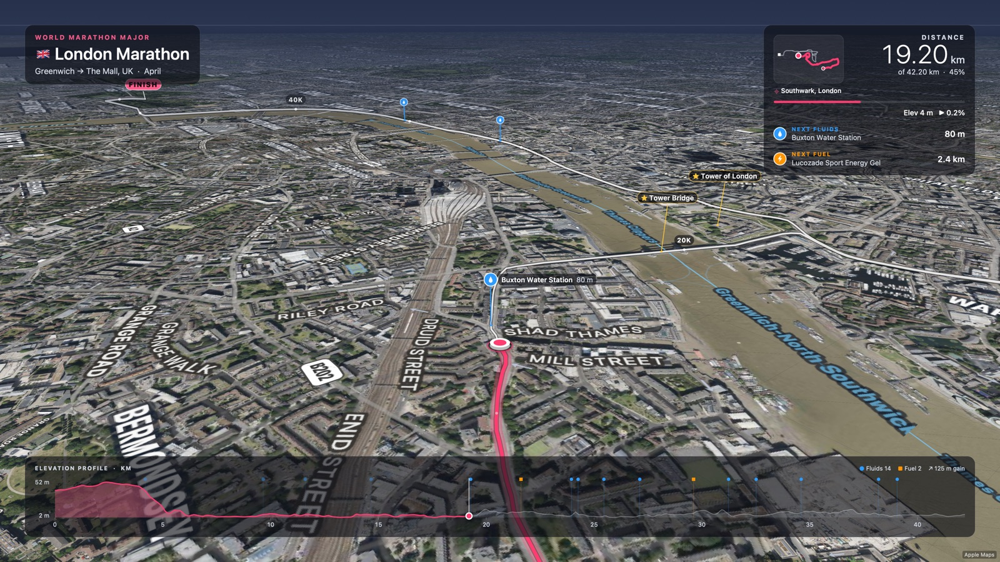
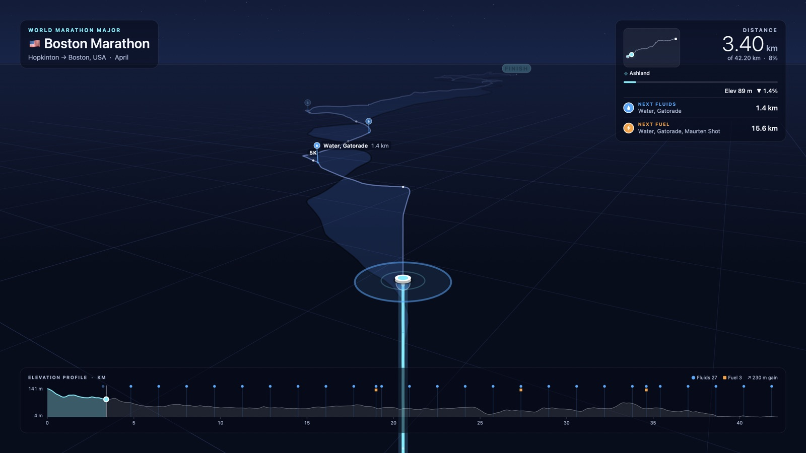
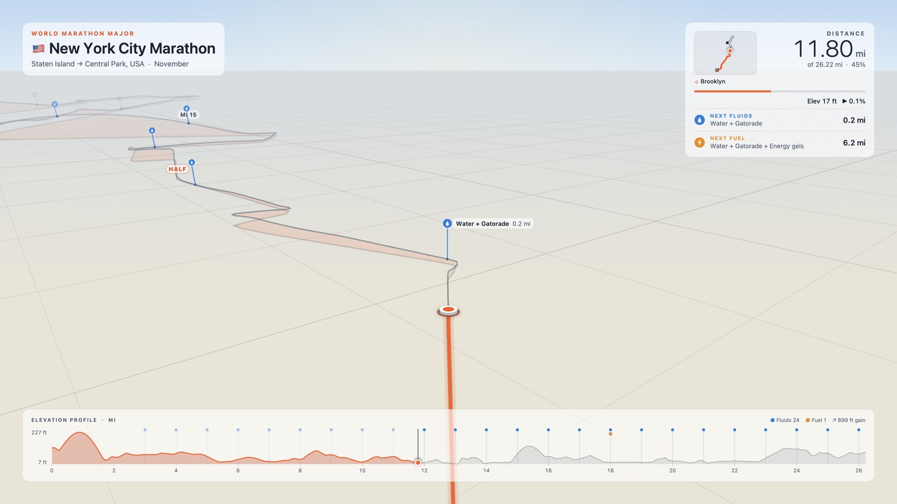
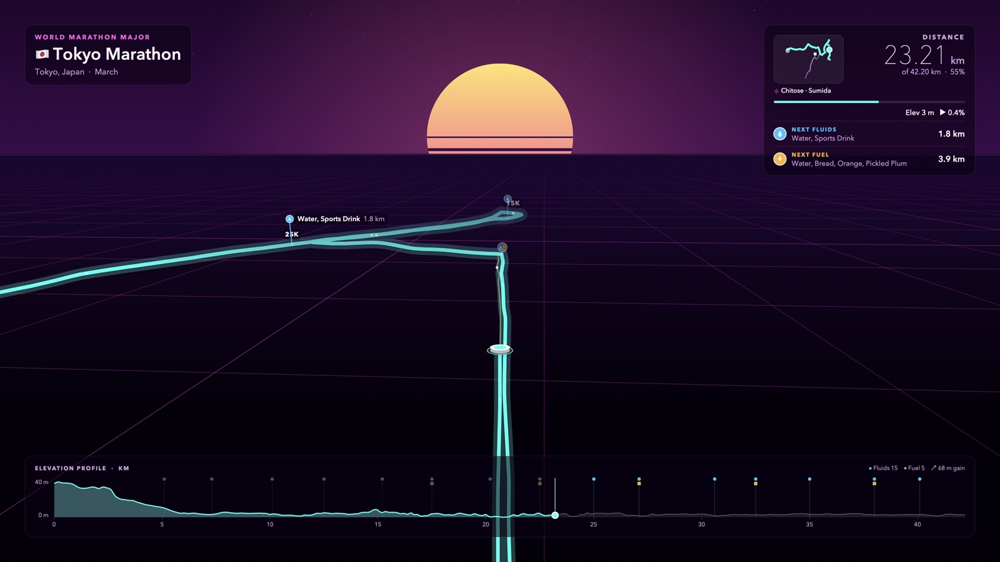
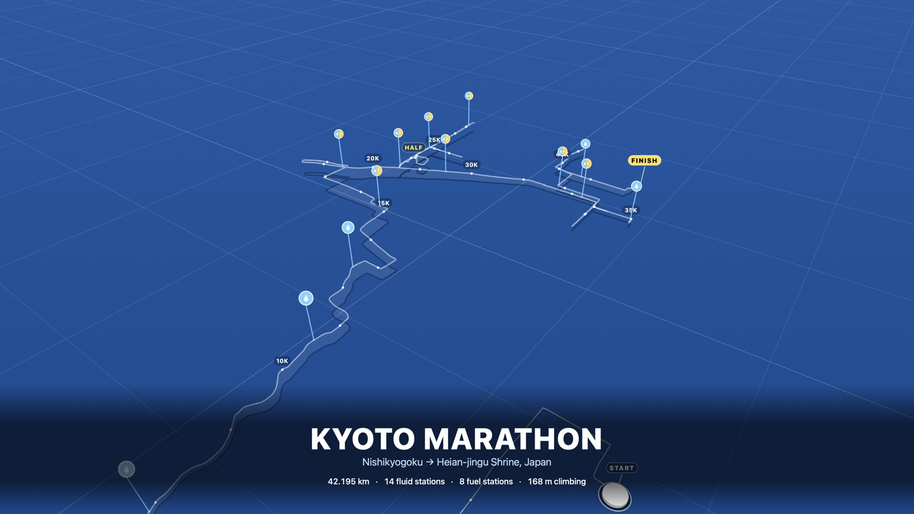
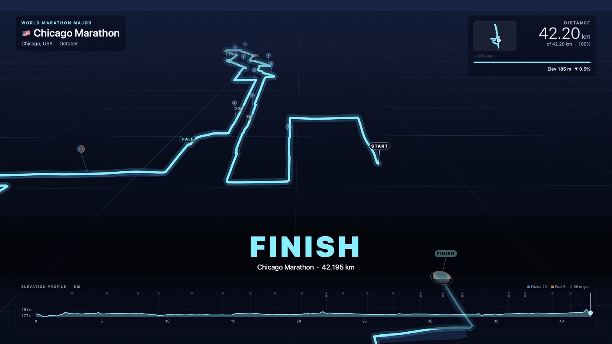
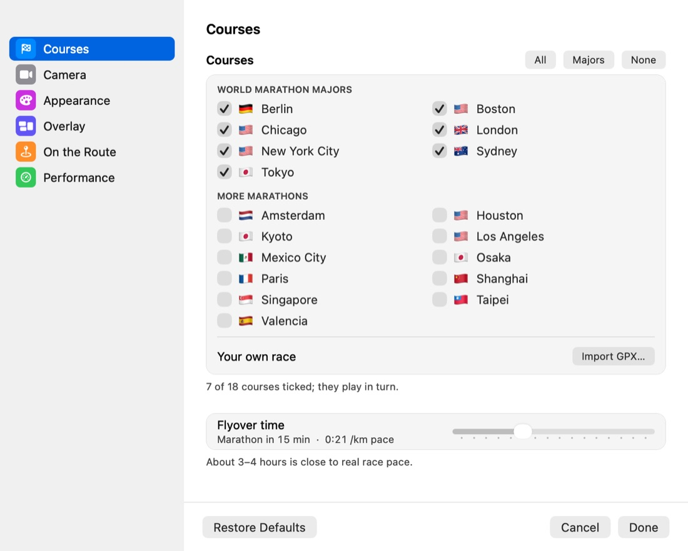
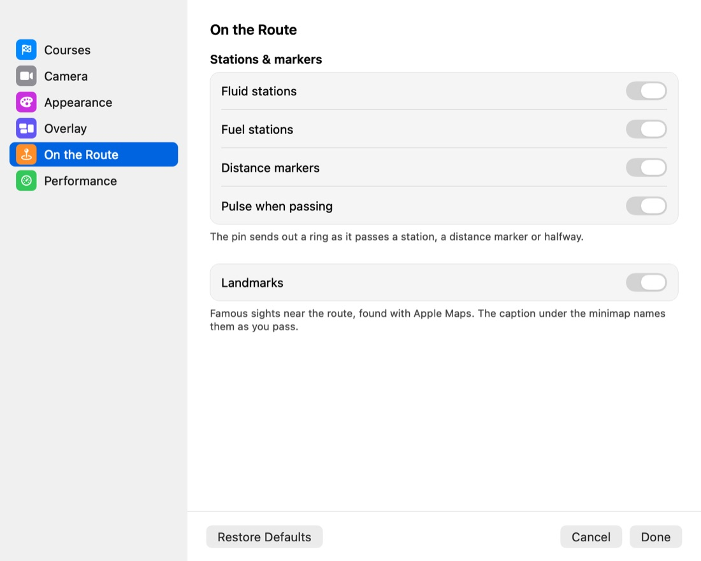

# marathon-screensaver

## Race Flyover: get to know your marathon course while your Mac rests

Race Flyover is a screensaver for your Mac that flies you along the world's big marathon courses.
A runner travels the route from start to finish while the camera glides behind, so over time you
learn the turns, the hills, where the water and gel stations are, and which landmarks you'll pass.

Leave it running in the background for a calm, beautiful course map, or slow it down and zoom in
for a detailed street-by-street preview before race day.


## Screenshots


*London over Apple Maps imagery, with Tower Bridge and the Tower of London coming up, the next water and gel
stations, a minimap of the whole course, and the elevation profile along the bottom.*

| | |
|---|---|
|  |  |
| **Boston** · the pin sends out a ring as it passes a water station | **New York** · the Daylight look, in miles |
|  |  |
| **Tokyo** · the Neon Grid look | **Kyoto** · each course opens with a title card |
|  |  |
| **Chicago** · and closes with a finish card | **Settings** · pick exactly which races to fly |

## What you'll see

- **18 big-city marathons**, including all seven World Marathon Majors (Boston, London, Berlin,
  Chicago, New York, Tokyo and Sydney) plus Kyoto, Amsterdam, Paris, Valencia, Los Angeles, Houston,
  Mexico City, Osaka, Singapore, Taipei and Shanghai. You can also add your own race from a GPX file.
- **Water and fuel stations** along the route, with the next ones always shown: what they hand out
  and how far away they are.
- **Distance markers** every kilometre or mile, and a marker at halfway.
- **Famous landmarks** labelled as you approach them, such as Tower Bridge, the Brandenburg Gate or
  Kyoto's Togetsukyo Bridge.
- **A minimap** of the whole course showing where you are, with the name of the neighbourhood
  you're running through.
- **An elevation profile** so you can see the hills coming, plus the total climb.
- **The runner's pin** lying on the ground with a trail behind it, and a pulse whenever you pass a
  station, a marker or halfway.
- **A title card** at the start of each course and a **finish card** at the end, placed low on the
  screen so they never clash with the clock macOS shows on the lock screen.

## Settings

Open **System Settings › Screen Saver**, choose **Race Flyover** and click **Options…**. The
settings are grouped like the rest of System Settings:



| Group | What you can change |
|---|---|
| **Courses** | Tick the races you want; they play one after another. Import your own race. Choose how long a full course takes, from a two-minute tour to a real-time four hours. |
| **Camera** | Follow behind the runner, keep north at the top, or watch the whole course from above with a slow orbit. Adjust how steeply the camera looks down and how close it sits. |
| **Appearance** | Fly over Apple Maps (satellite or street map, with optional 3D buildings), or one of five drawn looks: Midnight, Neon Grid, Daylight, Blueprint and Minimal Mono. Choose the pin and trail colours. |
| **Overlay** | Show all the information panels, just the essentials, or nothing. Solid panels or Apple's Liquid Glass. Kilometres or miles. Pick a typeface and text size. |
| **On the Route** | Turn water stations, fuel stations, distance markers, the passing pulse and landmarks on or off. |
| **Performance** | Choose what happens on multiple screens and set the frame rate. |

## What you need

- A Mac running **macOS 14 Sonoma or later** (Apple silicon or Intel). Liquid Glass panels need
  **macOS 26** or later.
- An **internet connection** the first time you use the Apple Maps looks, and for neighbourhood
  names and landmarks. The drawn looks work completely offline.
- To build it yourself: **Xcode** or Apple's free Command Line Tools.

## How it works

Each course is a list of points along the real race route, with the height of the ground at each
point and the positions of the water and fuel stations. Race Flyover moves a runner along those
points at the speed you choose, and a virtual camera follows from behind and above, turning
smoothly with the road.

For the Apple Maps looks, Race Flyover uses Apple Maps itself, so you see real streets, rivers,
parks and, if you like, 3D buildings. For the drawn looks, it sketches the route, a grid and the
hills itself, which is lighter and works without the internet.

On top of that sit the information panels: course name and flag, distance, the next stations, the
minimap and the elevation profile. Neighbourhood names and landmarks come from Apple Maps too, and
are remembered so each course only needs looking up once.

## Build & install

1. Download or clone this project.
2. Open **Terminal** in the project folder and run:

   ```bash
   ./build.sh install
   ```

3. Open **System Settings › Screen Saver**, scroll down to **Other**, and choose **Race Flyover**.
4. Click **Options…** to pick your courses and style.

To try it in a window first, run `./build.sh preview`. In the preview window, the Space bar pauses,
the left and right arrows jump a kilometre, and **N** skips to the next course.

**Adding your own race:** in Options, open **Courses** and click **Import GPX…**. Most race websites
and running apps can export a course as a GPX file. If the file includes points named "water", "aid",
"gel" or "food", they become stations. You can also drop GPX files into the `Courses` folder of this
project and run `./build.sh install` again.

## Notes

**Smooth playback.** The Apple Maps looks with 3D buildings are the most demanding: they can keep a
Mac's processor quite busy. If playback isn't smooth:

- set **Frame rate** to 30 fps (it's still smooth, and much lighter than 60);
- turn off **3D buildings & terrain** (this cuts the work to about a third);
- with more than one screen, choose **Main display only**: each screen draws its own copy otherwise.

The drawn looks (Midnight, Neon Grid and so on) are much lighter than any Apple Maps look.

**Accuracy.** The courses follow published race routes and are scaled to exactly 42.195 km, but
routes change from year to year. Where a race didn't publish its stations, Race Flyover shows them
every 5 km and says so on screen. Always check your race's official course map and runner guide
before race day.

**Where the course data comes from.** Most routes and stations come from the community collection
[distanzrunning/gpx](https://github.com/distanzrunning/gpx), which doesn't state a licence. Kyoto's
route comes from [GoAndRace](https://www.goandrace.com/en/map/2025/kyoto-marathon-2025-kyoto-course-map-1.php)
and its stations from the official 2025 runner guide. Please keep this project for personal use.

**For tinkerers.** `tools/build_courses.py` rebuilds the course files, and the preview app can save
still pictures and short animations of any course; the options are listed at the top of
`Sources/Preview/main.swift`.
